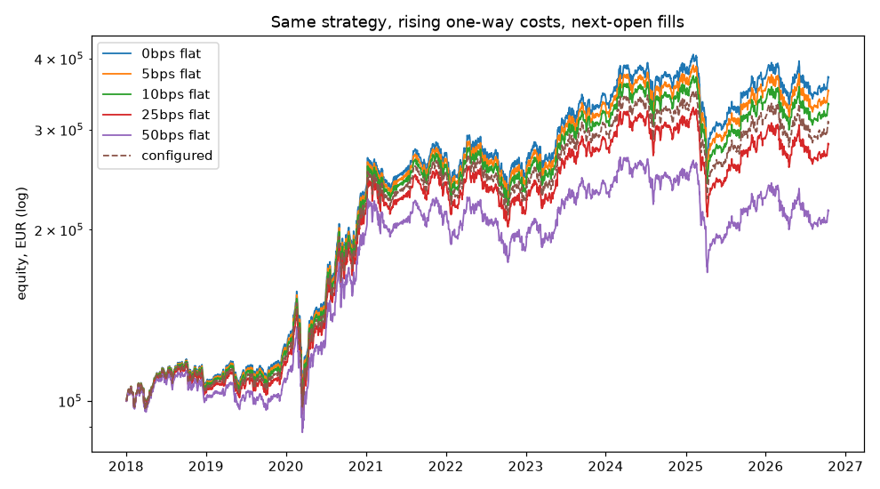

# Costs and frictions (day 36)

Reproduce with:

```bash
.venv/bin/python tools/cost_sweep.py --as-of 2026-10-15 --start 2018-01-01
```

One rotating placeholder strategy — top 10 of the stored universe by trailing
63-session EUR return, held 21 sessions, every order filled at the **next
session's open** — run at a flat one-way cost of 0 to 50bps, and at the cost
model configured in `config/settings.yaml` (5bps commission + half of a 10bps
spread + 5bps slippage, the last two scaled by `100M EUR / adv_eur_21`, clipped
to 1x–10x).

| costs       | final EUR | CAGR % | costs paid EUR | fills | turnover x/yr | avg bps |
|-------------|----------:|-------:|---------------:|------:|--------------:|--------:|
| 0bps flat   |   370,649 |  16.09 |              0 |  1180 |         12.57 |    0.00 |
| 5bps flat   |   351,115 |  15.37 |         13,444 |  1180 |         12.56 |    5.00 |
| 10bps flat  |   332,622 |  14.66 |         26,026 |  1180 |         12.56 |   10.00 |
| 25bps flat  |   282,847 |  12.57 |         59,086 |  1180 |         12.53 |   25.00 |
| 50bps flat  |   216,041 |   9.17 |        101,079 |  1180 |         12.50 |   50.00 |
| configured  |   309,095 |  13.71 |         42,068 |  1180 |         12.55 |   16.89 |



**Is it plausible?** Turnover (buys plus sells over average equity) is about
12.5x a year, so a one-way cost of c should cost roughly 12.5 x c a year: 6.3
points at 50bps. CAGR falls 6.9 points, from 16.1% to 9.2% — the rule of thumb
plus the compounding of what was paid. Every fill pays exactly its stated
rate, the picks and fill dates are identical across runs, and the drag is
monotone in cost. The configured model averages 17bps a fill here, because a
few names in the universe trade under 100M EUR a day.

The score is a placeholder with realistic turnover, not a finding; day 38's
baselines are the first numbers that mean anything.
