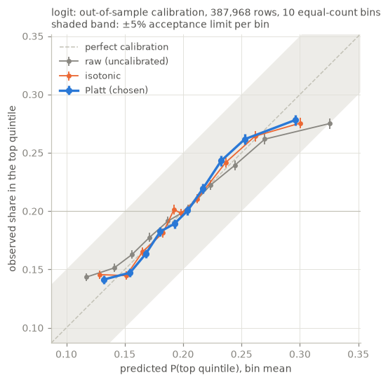

# Classifier: logit, P(top quintile), Platt-calibrated

Generated by `finmgr classify --model logit --slice 63 --slice 0.25 --as-of 2026-11-12` from the local store, data as of 2026-11-12. The code is
`finmgr/models/classify.py` (target, folds, calibration, the check) and
`finmgr/report/calibration.py` (this page); rerun the command after any change
and commit the regenerated page and chart.

## The question

Instead of predicting the 21-session excess return, predict the probability
that a name finishes its date in the **top 20%** of the universe
by that return — the names a top-K book wants. Then check that the probability
means what it says: of all the rows given ~30%, about 30% should land in the
top quintile, out of sample.

## Calibration (the acceptance criterion)

**calibration curve close to the diagonal: ECE 0.0070 (limit 0.02), worst bin 0.0180 (limit 0.05).**

Out-of-sample rows: 387,968 (every test date with a known outcome, 4,027 dates). Observed top-quintile share 20.27%; a flat 20% forecast scores Brier 0.1616 and log loss 0.5041.

| Method | ECE | Worst bin | Brier | Brier skill vs flat 20% | Log loss | AUC | 5th to 95th pct of P |
|---|---:|---:|---:|---:|---:|---:|---:|
| isotonic | 0.0068 | 0.0247 | 0.1599 | +1.03% | 0.4993 | 0.577 | [0.134, 0.286] |
| Platt **(chosen)** | 0.0070 | 0.0180 | 0.1598 | +1.13% | 0.4984 | 0.580 | [0.136, 0.287] |
| raw (uncalibrated) | 0.0122 | 0.0505 | 0.1603 | +0.84% | 0.4998 | 0.577 | [0.121, 0.314] |

ECE is the row-weighted mean |observed - predicted| over 10 equal-count bins; *worst bin* the largest such gap. The acceptance limits, fixed before the run, are ECE ≤ 0.02 and worst bin ≤ 0.05. A flat 20% forecast would pass them too, which is why Brier skill, AUC and the spread of the predictions sit beside them: the claim is *calibrated and informative*, and the honest size of *informative* is the Brier skill: +1.13% over the flat forecast.

### The Platt curve, bin by bin

| Bin | P range | Rows | Mean P | Observed | Gap | Naive 95% |
|---:|---|---:|---:|---:|---:|---:|
| 1 | [0.033, 0.147] | 38,797 | 0.132 | 0.141 | +0.009 | ±0.003 |
| 2 | [0.147, 0.162] | 38,797 | 0.155 | 0.147 | -0.007 | ±0.004 |
| 3 | [0.162, 0.174] | 38,797 | 0.168 | 0.163 | -0.005 | ±0.004 |
| 4 | [0.174, 0.187] | 38,796 | 0.180 | 0.183 | +0.002 | ±0.004 |
| 5 | [0.187, 0.199] | 38,797 | 0.193 | 0.189 | -0.003 | ±0.004 |
| 6 | [0.199, 0.210] | 38,797 | 0.204 | 0.200 | -0.003 | ±0.004 |
| 7 | [0.210, 0.224] | 38,796 | 0.217 | 0.220 | +0.002 | ±0.004 |
| 8 | [0.224, 0.242] | 38,797 | 0.233 | 0.243 | +0.011 | ±0.004 |
| 9 | [0.242, 0.266] | 38,797 | 0.253 | 0.262 | +0.009 | ±0.004 |
| 10 | [0.266, 0.712] | 38,797 | 0.296 | 0.278 | -0.018 | ±0.004 |

The naive interval treats rows as independent; neighbouring dates share 20 of their 21 label sessions, so the real uncertainty is several times wider.

### Year by year

| Year | Rows | Mean P | Observed | ECE (5 bins) | Worst bin |
|---|---:|---:|---:|---:|---:|
| 2011 | 21,278 | 0.203 | 0.201 | 0.0370 | 0.0855 |
| 2012 | 24,021 | 0.202 | 0.205 | 0.0326 | 0.0776 |
| 2013 | 24,554 | 0.206 | 0.205 | 0.0177 | 0.0343 |
| 2014 | 24,714 | 0.206 | 0.204 | 0.0195 | 0.0445 |
| 2015 | 24,954 | 0.204 | 0.203 | 0.0145 | 0.0208 |
| 2016 | 25,087 | 0.203 | 0.203 | 0.0194 | 0.0441 |
| 2017 | 24,944 | 0.203 | 0.203 | 0.0171 | 0.0302 |
| 2018 | 24,899 | 0.203 | 0.203 | 0.0159 | 0.0315 |
| 2019 | 24,936 | 0.202 | 0.203 | 0.0119 | 0.0157 |
| 2020 | 25,112 | 0.202 | 0.203 | 0.0057 | 0.0172 |
| 2021 | 25,102 | 0.203 | 0.203 | 0.0127 | 0.0316 |
| 2022 | 25,054 | 0.203 | 0.203 | 0.0177 | 0.0316 |
| 2023 | 25,091 | 0.203 | 0.202 | 0.0191 | 0.0299 |
| 2024 | 25,278 | 0.202 | 0.201 | 0.0268 | 0.0367 |
| 2025 | 25,148 | 0.202 | 0.201 | 0.0117 | 0.0318 |
| 2026 | 17,796 | 0.202 | 0.201 | 0.0172 | 0.0403 |

13 of 16 years are within the ECE limit on their own. The pooled curve is close to the diagonal; single years drift around it, because the slice a calibrator learns from is one regime and the test window the next.

### Slice length

The same classifier and folds, with the calibration slice set to each length below (a whole number is dates, a fraction is a share of the fold's training dates). Shown so the choice of slice is visible, not hidden:

| Slice | Method | ECE | Worst bin | Brier skill | AUC | Passes |
|---|---|---:|---:|---:|---:|---|
| 40% of training | isotonic | 0.0068 | 0.0247 | +1.03% | 0.577 | yes |
| 40% of training | Platt | 0.0070 | 0.0180 | +1.13% | 0.580 | yes |
| 40% of training | raw (uncalibrated) | 0.0122 | 0.0505 | +0.84% | 0.577 | no |
| 63 dates | isotonic | 0.0171 | 0.0544 | +0.35% | 0.576 | no |
| 63 dates | Platt | 0.0136 | 0.0456 | +0.79% | 0.575 | yes |
| 63 dates | raw (uncalibrated) | 0.0077 | 0.0306 | +1.26% | 0.584 | yes |
| 25% of training | isotonic | 0.0107 | 0.0402 | +0.85% | 0.576 | yes |
| 25% of training | Platt | 0.0079 | 0.0231 | +1.01% | 0.578 | yes |
| 25% of training | raw (uncalibrated) | 0.0129 | 0.0537 | +0.61% | 0.579 | no |

## How each probability was made

|  |  |
|---|---|
| Classifier | `logit` (C=1.0, fit_intercept=True, max_iter=1000) |
| Target | `top20_fwd_xs_21d`: 1 if `fwd_xs_21d` ranks in the date's top 20% of known labels |
| Features | `ret_21d`, `mom_12_1`, `vol_63d`, `dist_sma_200`, `macd_hist_pct`, `adv_eur_21`, `volume_z_63`, `beta_252`, `mom_resid_12_1_sec`, `rev_5d_sec` — per-date ranks, missing → 0.5 |
| Folds | day 42's: walk-forward, expanding, test 63 dates, min train 200, embargo 21 — the same test windows as ridge and LightGBM |
| Calibration slice | the last 40% of training dates of each fold's training window, held out of the classifier's fit; training dates whose label reaches into the slice are purged |
| Calibrator | Platt, fitted on the slice only; isotonic and Platt are fitted on the same slice for the comparison above |
| Fold 0 | fit 2010-01-11 → 2010-07-14 (132 dates), calibrate 2010-08-16 → 2011-01-05, test 2011-02-14 → 2011-05-12 |
| Folds | 65, last test window 2026-09-24 → 2026-10-15 |

## The book it trades, against the baselines

The book ranks each test date on the classifier's raw probability: calibration
is monotone, so it cannot change who is in the top 10, and ranking on
the raw score keeps the ordering isotonic's steps would tie. Same engine,
window (2011-03-01 → 2026-10-15), top 10, held 21 sessions,
configured costs and next-open fills as every baseline.

**does not beat the bar: Sharpe 0.85 ≤ 1.08.** Sharpe 0.85, 95% interval
[0.35, 1.38]. With 8 variants now in `docs/trials.csv`, the familywise (99.38%) interval is [0.15, 1.59].

| Candidate | Sharpe | 95% interval | CAGR | Volatility | Max drawdown | Turnover (x/yr) |
|---|---:|---|---:|---:|---:|---:|
| equal weight, rebalanced **← the bar** | 1.08 | [0.54, 1.65] | 16.62% | 14.74% | -33.06% | 0.31 |
| equal weight, buy-and-hold | 1.03 | [0.52, 1.56] | 21.18% | 20.11% | -33.56% | 0.00 |
| 12-1 momentum, top-K | 0.97 | [0.51, 1.46] | 21.26% | 21.69% | -30.36% | 3.11 |
| random top-K, 95th percentile | 0.91 | 200 runs | - | - | - | - |
| logit P(top 20%), walk-forward **← model** | 0.85 | [0.35, 1.38] | 17.20% | 20.54% | -36.15% | 5.16 |
| benchmark | 0.78 | [0.28, 1.30] | 12.12% | 15.33% | -33.63% | 0.00 |

| Paired difference | Sharpe | 95% low | 95% high | P(diff ≤ 0) |
|---|---:|---:|---:|---:|
| logit P(top 20%), walk-forward minus equal weight, rebalanced | -0.23 | -0.56 | +0.07 | 93.4% |
| logit P(top 20%), walk-forward minus equal weight, buy-and-hold | -0.18 | -0.57 | +0.19 | 83.2% |
| logit P(top 20%), walk-forward minus 12-1 momentum, top-K | -0.12 | -0.54 | +0.30 | 71.3% |
| logit P(top 20%), walk-forward minus benchmark | +0.06 | -0.29 | +0.40 | 35.6% |

## What it learnt

Logistic weights are on the log-odds of a top-quintile finish, per unit of a
feature's rank (bottom → top of the day = 1).

65 folds, refitted every 63 dates; expanding window from 2010-01-11; first test 2011-02-14 (trained on 12,022 rows to 2010-07-14), last test ending 2026-10-15 (trained on 243,159 rows). Embargo 21 dates, purged on each date's latest label end across venues.

Out-of-sample rank IC (Spearman of score vs realised fwd_xs_21d, per date): mean +0.030, std 0.201, IC/std +0.15, positive on 58% of 4,027 test dates. Naive t 9.4 treats the dates as independent; the 21-session labels overlap, so divide by roughly √21 ≈ 4.6 for an honest one (2.0).

| Feature | Mean weight | Last fold | Range over folds | Folds positive |
|---|---:|---:|---|---:|
| vol_63d | +1.2910 | +1.3026 | [+0.8914, +1.4526] | 100% |
| beta_252 | -0.4933 | -0.5047 | [-0.8760, +1.4160] | 5% |
| adv_eur_21 | -0.3175 | -0.2211 | [-0.5884, -0.2125] | 0% |
| dist_sma_200 | -0.2821 | -0.0946 | [-0.6983, +0.3777] | 2% |
| rev_5d_sec | +0.2812 | +0.2617 | [+0.1475, +0.4004] | 100% |
| ret_21d | +0.2168 | +0.0283 | [+0.0283, +0.5598] | 100% |
| mom_12_1 | +0.1700 | +0.0972 | [-0.7048, +0.5726] | 91% |
| volume_z_63 | -0.0770 | -0.0454 | [-0.3069, -0.0170] | 0% |
| macd_hist_pct | +0.0612 | -0.0304 | [-0.0462, +0.4715] | 55% |
| mom_resid_12_1_sec | -0.0386 | -0.1323 | [-0.5981, +1.0010] | 22% |

The HTML tearsheet (`finmgr classify --model logit --slice 63 --slice 0.25 --as-of 2026-11-12 --report`) is written to `data/reports/classify_logit_2026-11-12.html` (under the git-ignored `data/`).
